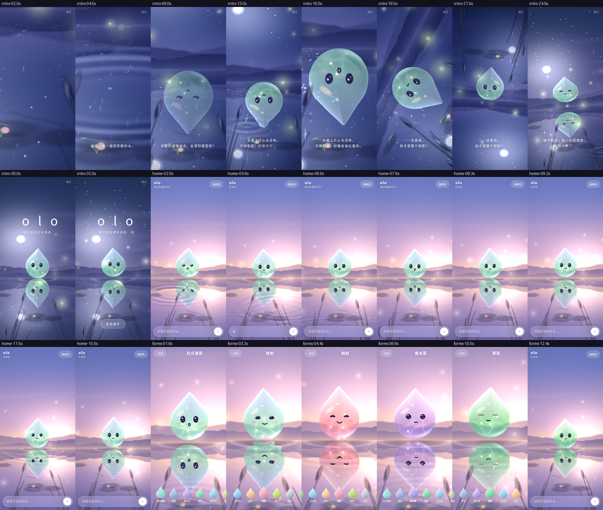

# olo 倒影国 · proto v2

One direction: a single-pass WebGL2 shader that draws the entire scene analytically, with no textures or models. Variant toggle: `?look=pixel`.
Quality checklist: [QUALITY.md](QUALITY.md). Run: `python3 -m http.server -d web/proto` → `/v2/`.

Params: `?screen=intro|home|forms` `?tod=0..2` (dusk/night/dawn) `?demo=home|forms` `?debug=1` (mood buttons) `?hud=1` `?look=pixel` `?capture=1` (deterministic frame capture).

- Character: SDF water drop. Squash-and-stretch idle, tip lag (secondary motion), blinking (including double blinks), saccades, gaze that follows the pointer, 4 moods (happy/curious/sleepy/sad, auto-sleep after 25s idle), refraction + subsurface + caustics + fresnel + dual highlights, contact shadow and reflection on the water, liquid fill when switching among the 10 colour forms.
- Ambient: sky cycle, stars/clouds/3 layers of mountain mist, wind on the reeds, fireflies/bokeh, fish shadows, lily pads, sun glitter path, ripples.
- Interaction: tap ripples, ripples while typing plus curious gaze, send → bubble flies into the mirror → a light mote travels to olo → reaction (hop/sad).
- Transitions: ripple wipe + camera spring. Intro ~32s: water surface → the reflection reveals olo → push-in → 180° roll for the role swap → title.
- Performance: dpr ≤1.5 + adaptive resolution. Not yet measured on a real iPhone; this box only has software rendering.

